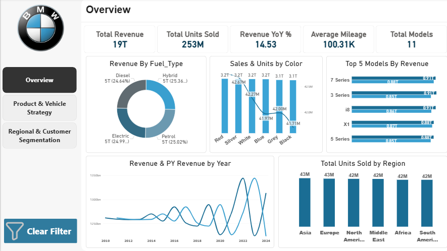

BMW Car Sales Analytics Dashboard

An interactive three-page Power BI report that analyses 50,000 BMW sales records (2010 to 2024) by model, fuel type, region, and sales class.

Report pages
Page	Question it answers
Overview	How much did we sell, and how is revenue changing?
Product & Vehicle Strategy	Which vehicle features go with higher sales?
Regional & Customer Segmentation	How do regions and sales classes compare?
Highlights
20 DAX measures (revenue, units, YoY growth, eco and diesel share, regional revenue)
Flat single-table model built from one Excel sheet
Page navigator and Clear Filter buttons on every page
Full documentation

Data, Power Query steps, every DAX measure, design, and insights are explained in the PDF: docs/BMW_Sales_Dashboard_Documentation.pdf

Repository structure
text
├── README.md
├── BMW_Project.pbix                       Power BI report
├── data/BMW_Car_Sales_Classification.xlsx Source data
└── docs/BMW_Sales_Dashboard_Documentation.pdf
How to open
Install Power BI Desktop (free, Windows).
Open the .pbix file.
If the data is not found: Home > Transform data > Data source settings > Change Source, select the Excel file in data, then Refresh.
Note

The data looks synthetic, so the insights are for practice, not real BMW results.

Author

Safa, @SafaAshraf500
